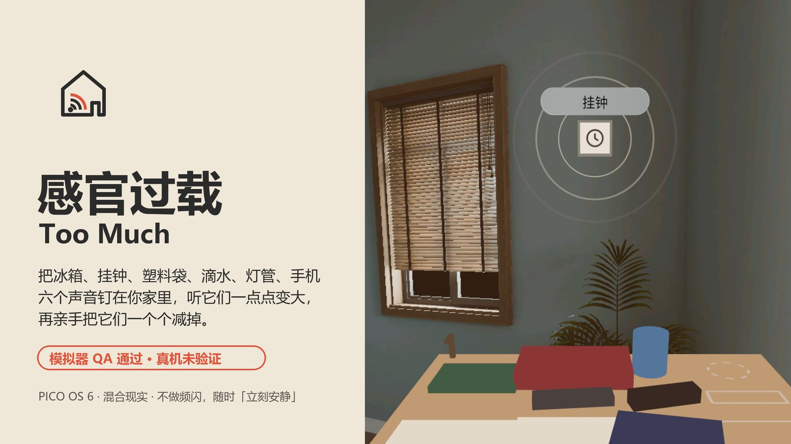
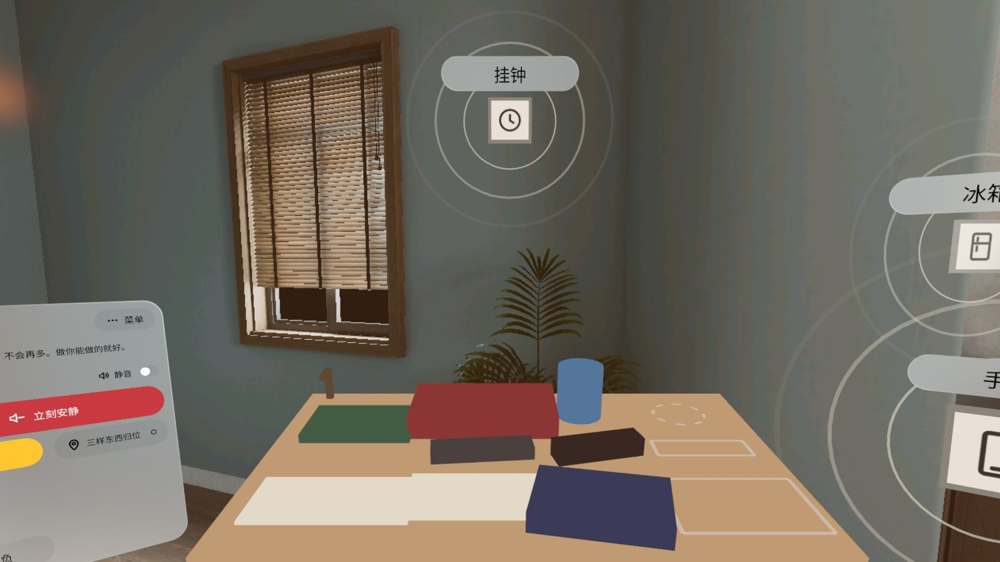
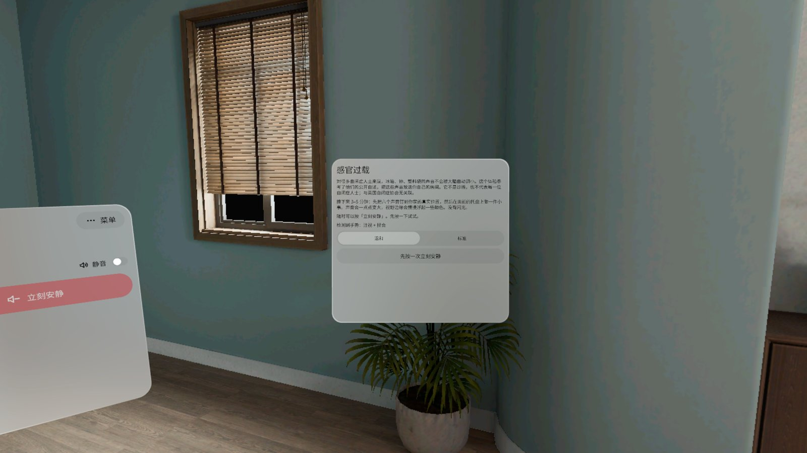
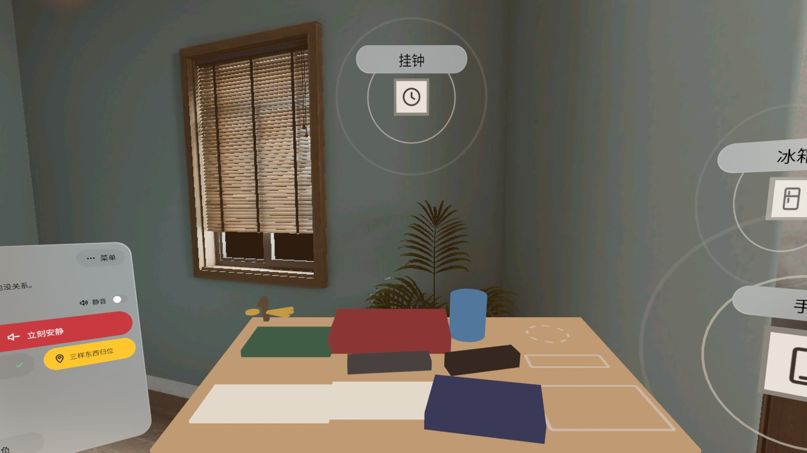
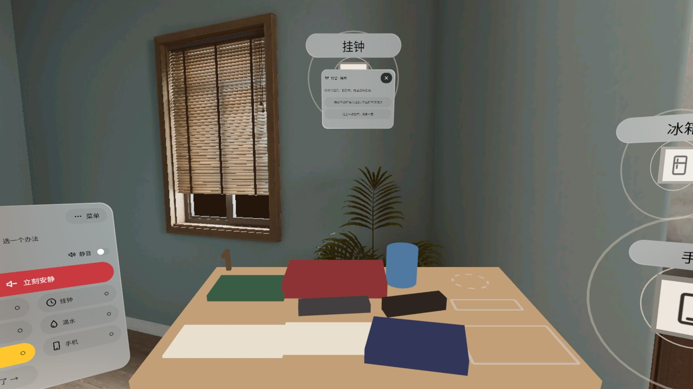
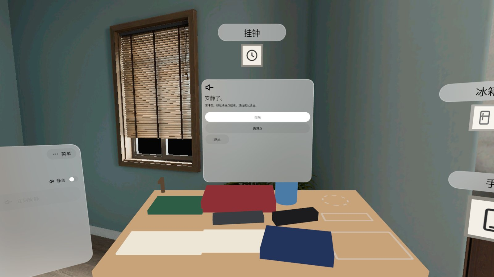
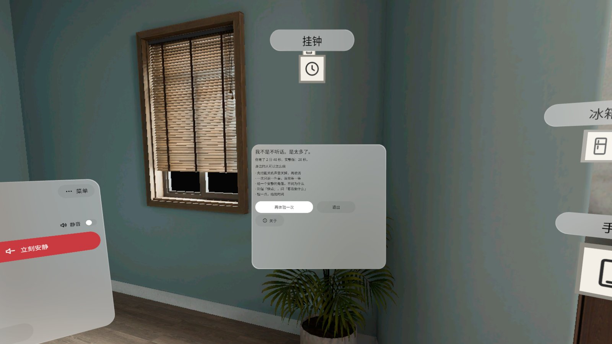

# 感官过载 Too Much

> **v0.1.0 · 预发布 · 模拟器 QA 通过，真机未验证**（Pre-release · passed emulator QA, not yet verified on a headset）



> **感官提示**：这是一个模拟感官过载的体验，声音会逐渐变大，视野边缘会浮起柔和的色块。**没有频闪，没有强闪光**，亮度变化缓慢、有上限。对声音或光线敏感、或者有光敏性癫痫史的人请谨慎使用。**随时按随身面板上红色的「立刻安静」**：0.5 秒内所有声音静下来、色块 1 秒内淡出；面板第 3 行的「静音」开关会一直关掉声音（会记住）。
>
> **Sensory notice**: this experience simulates sensory overload. Sounds slowly get louder and soft colours drift at the edge of your view. **No strobing, no bright flashes**; brightness changes are slow and capped. Use with care if you are sensitive to sound or light, or have a history of photosensitive epilepsy. **Press the red "Quiet now" on the body panel at any time**: every sound goes silent within 0.5 s and the colours fade out within 1 s. The "Mute" switch on the panel's third row keeps the sound off (remembered).

[中文](#中文) · [English](#english)

---

## 中文

坐在自己家里体会「信息太多」。PICO OS 6 混合现实应用：把冰箱嗡鸣、挂钟滴答、塑料袋、滴水、灯管蜂鸣、手机提示六个声音钉在你家真实的位置上，然后在面前的托盘上找钥匙、把三样东西放回去。声音一点点变大，视野边缘浮起慢慢漂的光斑，三十秒的小事做成了三分钟。最后你亲手把每个声音「减负」掉，再做一遍，几秒就完。

文字改写自自闭症人士的公开自述和英国自闭症协会 Too Much Information 活动的公开材料。本应用**与英国自闭症协会无关联**，不是诊断工具，也不代表每一位自闭症人士的感受。

- **钉声源**：注视 + 捏合（或手柄射线 + 扳机）把六个声音钉到你家的冰箱、钟、窗边；可以近一点 / 远一点、摇杆转、放默认位、删除，或「自动摆好」。位置存在空间锚点里，下次打开直接用。
- **任务**：托盘上按住候选物看下面有没有钥匙、钥匙挂到钩上、杯子 / 眼镜 / 书拖回虚线框。塑料袋和手机响起时会把手里的东西打回原位——这是模拟，不是考试，做不完也没关系。
- **一点点变大**：声音分五级，每级至少 3 秒缓动，最早 60 秒到顶，到顶就停；光斑只在视野中心 35° 以外。
- **减负**：看着一个声音、捏合，从卡片上选一个办法（关掉提示音、换个房间、拧紧水龙头……），涟漪当场收拢。处理过 3 个以上就能「安静版再做一遍」，结尾卡对比两次用时，并给出五条身边的人可以怎么做。
- **安全**：「立刻安静」常驻面板；默认「温和」强度（再压 8 dB）；退后台回来停在安静卡，不会自己出声。中英双语，不联网，不需要账号。

### 截图（模拟器，中文界面）

| | |
|---|---|
|  平台期：挂钟三圈涟漪，左上 / 右上光斑在视野边缘 |  开场卡：先按一次「立刻安静」才能继续 |
|  钥匙已上钩，把三样东西拖回虚线框 |  减负卡：灯管的两个办法 |
|  立刻安静：声音和光斑都停下，可以继续、去减负或退出 |  结尾：两次用时 + 身边的人可以怎么做 |

截图都来自 PICO 模拟器（High Definition 2560），状态用调试广播定住拍摄。演示视频（Release 附件 `TooMuch-demo-1080p.mp4`）是模拟器上由调试输入驱动的演示，**非真实手势录像**，无声。

### 安装

```bash
adb install -r TooMuch-v0.1.0.apk
pico-cli app launch io.embodit.toomuch
```

APK 在 [Release v0.1.0](https://github.com/kejing-dev/TooMuch/releases/tag/v0.1.0)。需要 PICO OS 6（Spatial SDK 6.1.9，minSdk 35），在 Full Space 里运行。

### 真机未验证

模拟器上过了三道门禁（无 Material 组件、装机启动 60 秒无崩溃 / ANR、设计包 20 个状态全部截图核对），立刻安静实测约 0.5 秒、纱和光斑透明度都在上限内。下面这些只有戴上头显才能确认：

- 空间音频的方向、距离、HRTF；合成声音像不像冰箱 / 钟 / 塑料袋；开着声音连用 3 分钟会不会吵
- 手柄射线幽灵牌、扳机钉、摇杆推远拉近与左右转牌（模拟器没有手柄）
- 退后台再回来不自动出声（模拟器触发不了）
- 眼动注视 + 捏合钉远处的精度；纱和光斑在真实透视下的强弱；托盘高度是否舒适

### 已知问题（不挡用）

1. 灯管和远处声源的减负卡会停在挂钟牌正前方，把挂钟牌挡住（关卡后回来，也能从面板胶囊打开挂钟）。
2. 「立刻安静」实测 494–506 ms，偶尔超 0.5 秒几毫秒（淡出终点已接近 0，听不出）。
3. 随身面板在视野左 40°，模拟器视场窄时只露右半；真机视场更宽。
4. 静音开关「关」状态在浅色玻璃上偏淡。
5. 面板正文对比度约 4.7:1，刚过 4.5:1。
6. 声音文件合计 5.7 MB（分层循环），APK 51 MB。
7. 「其余帮我处理」要进入减负 60 秒后才出现（设计如此）。

### 开发

Kotlin · PICO Spatial SDK 6.1.9 · 一个 Mixed Stage（Full Space + 透视）。结构、调试广播、截图脚本见 [AGENTS.md](AGENTS.md)。声音全部由 `tools/gen_sounds.py` 程序合成（无版权素材）；字体 Noto Sans / Noto Sans SC（SIL OFL 1.1，见 `third_party/`）。

---

## English

Feel "too much information" in your own home. A PICO OS 6 mixed-reality app: pin six everyday sounds (a fridge hum, a ticking clock, a plastic bag, a dripping tap, a buzzing lamp, phone pings) to the real spots in your room, then find the keys and put three things back on a tray in front of you. The sounds slowly grow and soft blobs drift at the edge of your view, and a 30-second chore turns into three minutes. Then you unload each sound yourself and do the task again: done in seconds.

The text is adapted from autistic people's public accounts and the National Autistic Society's Too Much Information campaign materials. This app is **not affiliated with or endorsed by the National Autistic Society**. It is not a diagnostic tool and does not speak for every autistic person.

- **Pin the sounds**: gaze + pinch (or the controller ray + trigger) on your fridge, clock, window; nearer / farther, stick to turn, default spot, delete, or "Auto-place". Spots are stored as spatial anchors and come back next time.
- **The task**: hold a candidate to look under it for the keys, hang the keys on the hook, drag the mug, glasses and book back into their outlines. The bag and phone knock what you hold back into place. It is a simulation, not a test; not finishing is fine.
- **Slowly louder**: five levels, every step eased over at least 3 s, the top no earlier than 60 s, then it stays there; blobs only appear more than 35° off the centre of view.
- **Unload**: look at a sound, pinch, pick one thing to do (turn off the alert tone, use another room, tighten the tap…) and its ripples collapse on the spot. After three, do the task once more in the quiet; the ending card compares both times and lists five things people around can do.
- **Safety**: "Quiet now" is always on the panel; the default "Gentle" strength presses everything 8 dB down; coming back from the background lands on the quiet card with no sound. Chinese and English; offline, no account.

### Screenshots

See the table above (Chinese UI on the PICO emulator, High Definition 2560, states pinned with debug broadcasts). The demo video in the release (`TooMuch-demo-1080p.mp4`) is driven by debug input on the emulator — **not a recording of real hand gestures** — and has no sound.

### Install

```bash
adb install -r TooMuch-v0.1.0.apk
pico-cli app launch io.embodit.toomuch
```

The APK is in [Release v0.1.0](https://github.com/kejing-dev/TooMuch/releases/tag/v0.1.0). Requires PICO OS 6 (Spatial SDK 6.1.9, minSdk 35); runs in Full Space.

### Not yet verified on a headset

Passed three emulator gates (no Material components, install + 60 s with no crash / ANR, all 20 design states screenshotted and checked); "Quiet now" measured at about 0.5 s and the haze / blob opacities stay under their caps. Only a headset can confirm:

- spatial audio direction, distance and HRTF; whether the synthesised sounds read as a fridge / clock / bag; whether 3 minutes with sound on is too much
- controller ray ghost card, trigger pinning, stick push / pull and turn (the emulator has no controller)
- no sound after coming back from the background (cannot be triggered on the emulator)
- gaze + pinch precision for far spots; how strong the haze and blobs feel in real passthrough; tray height comfort

### Known issues (not blocking)

1. The unload card for the lamp and far sources sits in front of the clock card and hides it (it comes back when the card closes; the clock can also be opened from its capsule).
2. "Quiet now" measured 494–506 ms, a few ms over 0.5 s now and then (the fade is near zero by then; inaudible).
3. The body panel is 40° to the left; on the emulator's narrow view only its right half shows. A headset's view is wider.
4. The mute switch's "off" state is faint on light glass.
5. Panel body text contrast is about 4.7:1, just above 4.5:1.
6. Sound files total 5.7 MB (layered loops); the APK is 51 MB.
7. "Do the rest for me" appears 60 s into unloading (by design).

### Development

Kotlin · PICO Spatial SDK 6.1.9 · one Mixed Stage (Full Space + passthrough). Structure, debug broadcasts and screenshot scripts: [AGENTS.md](AGENTS.md). Every sound is synthesised by `tools/gen_sounds.py` (no third-party audio); fonts Noto Sans / Noto Sans SC (SIL OFL 1.1, see `third_party/`).
