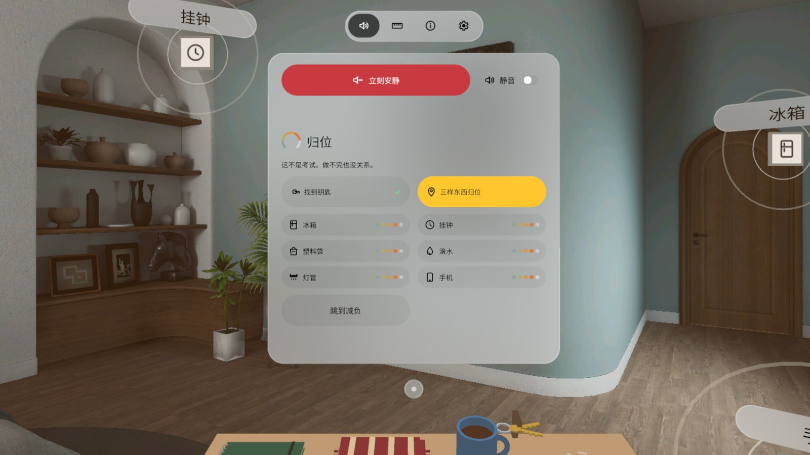
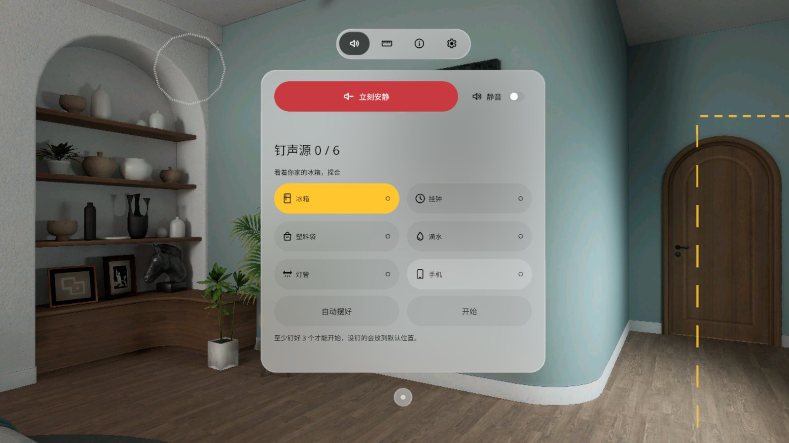
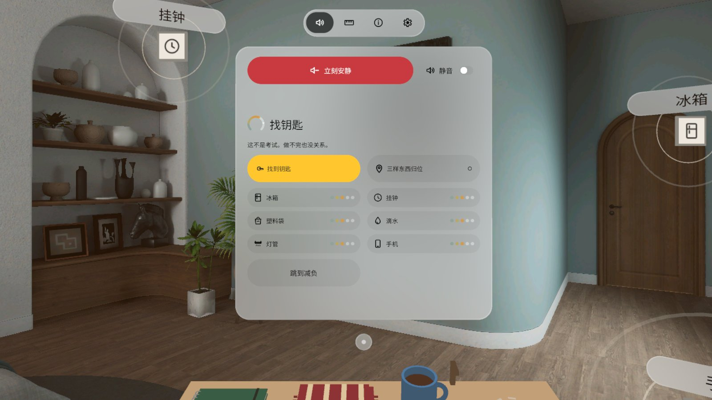
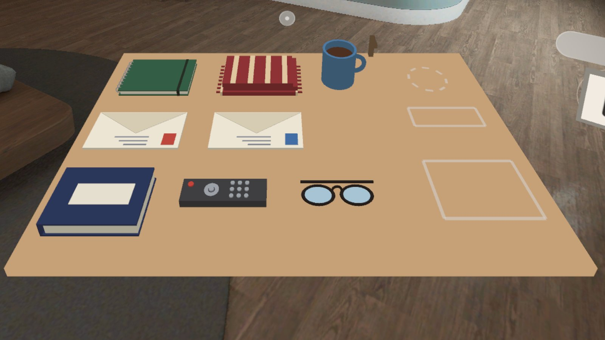
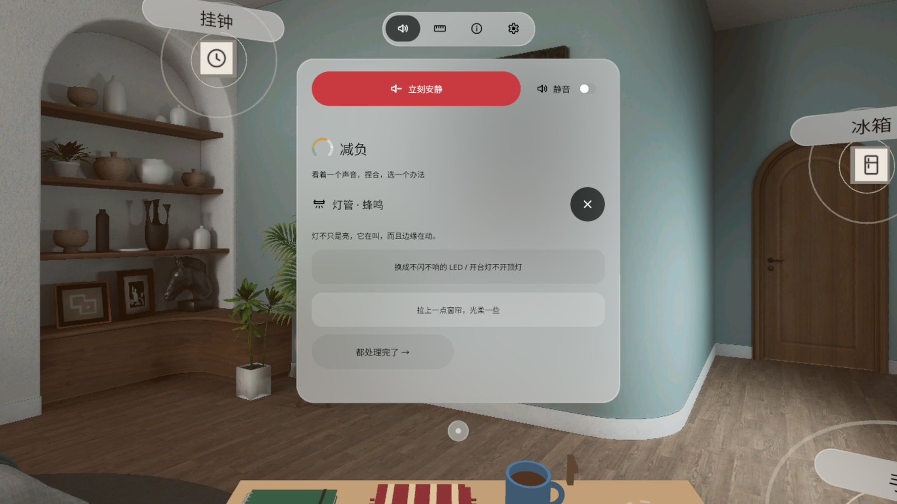
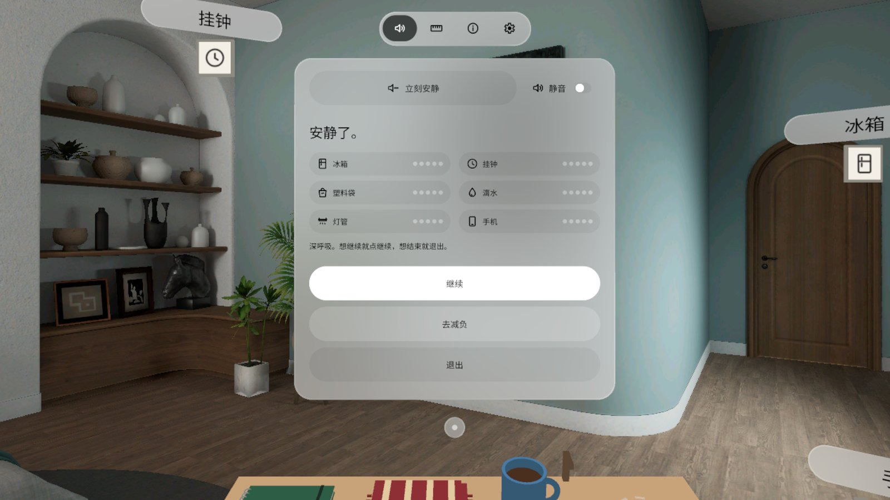
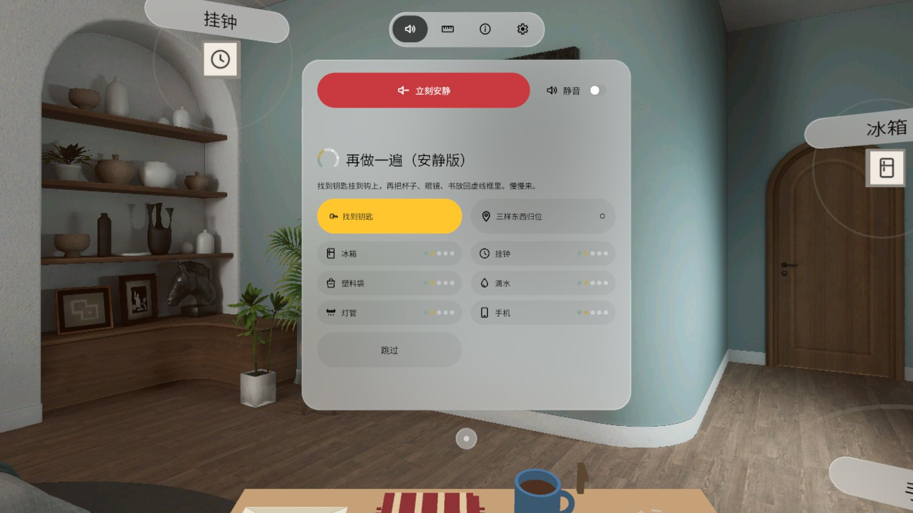

# 感官过载 Too Much

> **v0.1.2 · 预发布 · 模拟器 QA 通过，真机未验证**（Pre-release · passed emulator QA, not yet verified on a headset）

**安装 / Install**（APK 在 [Release v0.1.2](https://github.com/kejing-dev/TooMuch/releases/tag/v0.1.2)）：

```bash
adb install -r too-much-v0.1.2-debug.apk
pico-cli app launch io.embodit.toomuch
```

头显上如果装过别的电脑签名的旧版、报 `INSTALL_FAILED_UPDATE_INCOMPATIBLE`，先 `adb uninstall io.embodit.toomuch` 再装。
If an older build signed on another machine is installed and you get `INSTALL_FAILED_UPDATE_INCOMPATIBLE`, run `adb uninstall io.embodit.toomuch` first.



> **感官提示**：这是一个模拟感官过载的体验，声音会逐渐变大，视野边缘会浮起柔和的色块。**没有频闪，没有强闪光**，亮度变化缓慢、有上限。对声音或光线敏感、或者有光敏性癫痫史的人请谨慎使用。**随时按窗口顶上红色的「立刻安静」**：所有声音马上静下来、色块淡出；旁边的「静音」开关会一直关掉声音（会记住）。
>
> **Sensory notice**: this experience simulates sensory overload. Sounds slowly get louder and soft colours drift at the edge of your view. **No strobing, no bright flashes**; brightness changes are slow and capped. Use with care if you are sensitive to sound or light, or have a history of photosensitive epilepsy. **Press the red "Quiet now" at the top of the window at any time**: every sound goes silent at once and the colours fade out. The "Mute" switch next to it keeps the sound off (remembered).

[中文](#中文) · [English](#english)

---

## 中文

坐在自己家里体会「信息太多」。PICO OS 6 混合现实应用：把冰箱嗡鸣、挂钟滴答、塑料袋、滴水、灯管蜂鸣、手机提示六个声音钉在你家真实的位置上，然后在面前的托盘上找钥匙、把三样东西放回去。声音一点点变大，视野边缘浮起慢慢漂的光斑，三十秒的小事做成了三分钟。最后你亲手把每个声音「减负」掉，再做一遍，几秒就完。

文字改写自自闭症人士的公开自述和英国自闭症协会 Too Much Information 活动的公开材料。本应用**与英国自闭症协会无关联**，不是诊断工具，也不代表每一位自闭症人士的感受。

- **一个系统窗口**：所有 2D 界面合在一个原生窗口里，四个页签（体验 / 房间 / 怎么操作 / 设置），拖动、关闭用系统自带的控件；关掉后留一个小条，点一下重新打开
- **钉声源**：注视 + 捏合（或手柄射线 + 扳机）把六个声音钉到你家的冰箱、钟、窗边；也可以「自动摆好」。位置存在空间锚点里，下次打开直接用
- **真实录音**：六种实物声换成了 CC0 公有领域录音（来源见下面「声音来源」）
- **托盘任务**：9 件认得出的东西（钥匙、眼镜、带把手的杯子、书、围巾、信封、遥控器、笔记本），相邻至少隔 5 cm；按住候选物看下面有没有钥匙、钥匙挂到钩上、三样东西拖回虚线框。塑料袋和手机响起时会把手里的东西打回原位——这是模拟，不是考试，做不完也没关系
- **一点点变大**：声音分五级，每级至少 3 秒缓动，最早 60 秒到顶，到顶就停；光斑只在视野中心 35° 以外
- **减负**：看着一个声音、捏合，从卡片上选一个办法（关掉提示音、换个房间、拧紧水龙头……），涟漪当场收拢。处理过 3 个以上就能「安静版再做一遍」，对比两次用时
- **安全**：「立刻安静」常驻窗口顶部；默认「温和」强度；退后台回来停在安静卡，不会自己出声。中英双语，不联网，不需要账号

### 截图（模拟器，中文界面，v0.1.2）

| | |
|---|---|
|  钉声源：先钉三个，其余自动放到默认位置 |  找钥匙：挂钟、冰箱的涟漪一圈圈扩开 |
|  托盘：9 件认得出的东西，间隔 ≥ 5 cm |  减负卡：灯管的两个办法 |
|  立刻安静：可以继续、去减负或退出 |  安静版再做一遍 |

截图来自 PICO 模拟器（High Definition 2560），QA 第 3 轮（v0.1.2）拍的，状态用调试广播定住，裁成 16:9。演示视频（Release 附件 `too-much-v0.1.2-demo.mp4`）是**原生模拟器演示，调试输入驱动；非真实手势录像**，无声。

### 真机未验证

模拟器 QA 第 3 轮通过：无 Material 组件；中英冷启动各 65 秒无崩溃 / ANR；系统窗口、页签、系统关闭真实点过；立刻安静实测 36–49 ms；托盘 4 个布局种子都不重叠。下面这些只有戴上头显才能确认：

- CC0 录音的空间音频听感，开着声音连用 3 分钟会不会吵，「标准」档听不听得清
- 手柄射线 / 扳机 / 摇杆转牌，每个手柄几条射线；手柄、手势、注视三种输入；眼动捏合精度
- 窗口和托盘在真实距离下的大小，纱和光斑在透视下的强弱，退后台 / 回前台不出声，启动时的摆位

### 已知问题

1. 平视冷启动时，托盘前排（书、遥控器、眼镜）在模拟器视场的下沿外，低头约 25° 能全看到（托盘按设计在眼下 0.55 m）。
2. 托盘真实点按 20 次有 1 次没反应（紧跟在旁边那件被抬起之后），同一点复测 5 / 5 正常。
3. 模拟器空闲降帧时场景要建约 68 秒（60 fps 下 3.6 秒），真机待看。
4. 上面「真机未验证」那几项。

### 声音来源

六种实物声都是 [freesound.org](https://freesound.org) 上的 CC0（公有领域）录音，由 `tools/import_cc0.py` 切段、做循环、对齐响度；两个界面提示音是程序生成的。感谢录音作者：

- 冰箱：aunrea「Refrigerator Hum」 https://freesound.org/people/aunrea/sounds/485953/
- 挂钟：Greaseball「clock_ticking_mono.wav」 https://freesound.org/people/Greaseball/sounds/666582/
- 滴水：jodybruchon「Kitchen sink - dripping faucet.wav」 https://freesound.org/people/jodybruchon/sounds/459461/
- 灯管：Developer_Jake「Fluorescent lightbulb hum buzz (Extended)」 https://freesound.org/people/Developer_Jake/sounds/638895/
- 塑料袋：vladnegrila「plastic bag rustle」 https://freesound.org/people/vladnegrila/sounds/339961/
- 手机：Froey_「Phone notification on vibrate」 https://freesound.org/people/Froey_/sounds/759616/ ；Tundidor「phone notification.aif」 https://freesound.org/people/Tundidor/sounds/634507/

### 开发

Kotlin · PICO Spatial SDK 6.1.9 · 一个 Mixed Stage（Full Space + 透视）+ 一个系统窗口。结构、调试广播、截图脚本见 [AGENTS.md](AGENTS.md)。字体 Noto Sans / Noto Sans SC（SIL OFL 1.1，见 `third_party/`）。

---

## English

Feel "too much information" in your own home. A PICO OS 6 mixed-reality app: pin six everyday sounds (a fridge hum, a ticking clock, a plastic bag, a dripping tap, a buzzing lamp, phone pings) to the real spots in your room, then find the keys and put three things back on a tray in front of you. The sounds slowly grow and soft blobs drift at the edge of your view, and a 30-second chore turns into three minutes. Then you unload each sound yourself and do the task again: done in seconds.

The text is adapted from autistic people's public accounts and the National Autistic Society's Too Much Information campaign materials. This app is **not affiliated with or endorsed by the National Autistic Society**. It is not a diagnostic tool and does not speak for every autistic person.

- **One system window**: all 2D UI lives in one native window with four tabs (Experience / Room / How to / Settings); move and close it with the system controls. Closing leaves a small chip; tap it to reopen
- **Pin the sounds**: gaze + pinch (or the controller ray + trigger) on your fridge, clock, window, or "Auto-place". Spots are stored as spatial anchors and come back next time
- **Real recordings**: the six everyday sounds are now CC0 public-domain recordings (see "Sound credits")
- **The tray task**: nine recognisable things (keys, glasses, a mug with a handle, a book, a scarf, envelopes, a remote, a notebook), at least 5 cm apart. Hold a candidate to look under it for the keys, hang the keys on the hook, drag three things back into their outlines. The bag and phone knock what you hold back into place. It is a simulation, not a test; not finishing is fine
- **Slowly louder**: five levels, every step eased over at least 3 s, the top no earlier than 60 s, then it stays there; blobs only appear more than 35° off the centre of view
- **Unload**: look at a sound, pinch, pick one thing to do (turn off the alert tone, use another room, tighten the tap…) and its ripples collapse on the spot. After three, do the task once more in the quiet and compare both times
- **Safety**: "Quiet now" is always at the top of the window; the default strength is "Gentle"; coming back from the background lands on the quiet card with no sound. Chinese and English; offline, no account

### Screenshots

See the table above (Chinese UI on the PICO emulator, High Definition 2560, QA round 3 on v0.1.2, states pinned with debug broadcasts, cropped to 16:9). The demo video in the release (`too-much-v0.1.2-demo.mp4`) is an emulator demo driven by debug input — **not a recording of real hand gestures** — and has no sound.

### Not yet verified on a headset

It passed emulator QA round 3: no Material components; 65 s cold start in Chinese and English with no crash / ANR; the system window, tabs and system close tested with real taps; "Quiet now" measured at 36–49 ms; no overlaps across four tray layout seeds. Only a headset can confirm:

- how the CC0 recordings sound in spatial audio, whether 3 minutes with sound on is too much, whether "Standard" is loud enough
- controller ray / trigger / stick turning and how many rays each controller shows; controller, hand and gaze input; eye-pinch precision
- window and tray size at real distances, haze and blob strength in passthrough, no sound after coming back from the background, launch placement

### Known issues

1. On a level-head cold start the front row of the tray (book, remote, glasses) sits below the emulator's narrow view; looking down about 25° shows all of it (the tray is 0.55 m below eye level by design).
2. One in 20 real taps on the tray did nothing (right after the neighbouring item was lifted); five re-tests on the same spot all worked.
3. When the emulator idles at a low frame rate the scene takes about 68 s to build (3.6 s at 60 fps); to be checked on a headset.
4. The items under "Not yet verified on a headset" above.

### Sound credits

The six everyday sounds are CC0 (public domain) recordings from [freesound.org](https://freesound.org), cut, looped and level-matched by `tools/import_cc0.py`; the two UI cues are generated in code. Thanks to the recordists:

- Fridge: aunrea, "Refrigerator Hum" https://freesound.org/people/aunrea/sounds/485953/
- Clock: Greaseball, "clock_ticking_mono.wav" https://freesound.org/people/Greaseball/sounds/666582/
- Tap: jodybruchon, "Kitchen sink - dripping faucet.wav" https://freesound.org/people/jodybruchon/sounds/459461/
- Lamp: Developer_Jake, "Fluorescent lightbulb hum buzz (Extended)" https://freesound.org/people/Developer_Jake/sounds/638895/
- Plastic bag: vladnegrila, "plastic bag rustle" https://freesound.org/people/vladnegrila/sounds/339961/
- Phone: Froey_, "Phone notification on vibrate" https://freesound.org/people/Froey_/sounds/759616/ ; Tundidor, "phone notification.aif" https://freesound.org/people/Tundidor/sounds/634507/

### Development

Kotlin · PICO Spatial SDK 6.1.9 · one Mixed Stage (Full Space + passthrough) plus one system window. Structure, debug broadcasts and screenshot scripts: [AGENTS.md](AGENTS.md). Fonts: Noto Sans / Noto Sans SC (SIL OFL 1.1, see `third_party/`).
